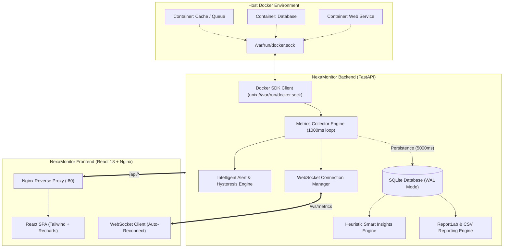

# NexaMonitor System Architecture
**Monitor. Analyze. Optimize.**  
*Comprehensive System Design & Architecture Specification (Phases 1 — 7)*

---

## 1. Architectural Overview

NexaMonitor is an enterprise-grade, real-time Docker container monitoring, historical telemetry analytics, and intelligent diagnostic platform. The application is built using a decoupled client-server architecture:

- **Frontend:** Single-Page Application (SPA) built with React 18, TypeScript, Vite, Tailwind CSS, shadcn/ui, and Recharts.
- **Backend:** High-performance asynchronous API server built with Python 3.11, FastAPI, SQLAlchemy ORM, SQLite (WAL mode), and Docker SDK for Python.
- **Real-Time Data Plane:** Dual WebSocket streams delivering sub-second differential metric snapshots (`/ws/metrics`) and sticky stdout/stderr log streams (`/ws/containers/{id}/logs`).
- **Intelligence Engine:** Deterministic rule-based heuristic analyzer identifying CPU saturation, memory leaks, flapping containers, and idle candidate over-provisioning.
- **Reporting Engine:** Automated telemetry aggregator producing RFC4180 CSV logs and vector PDF audit reports via ReportLab.

---

## 2. Core Subsystems

### 2.1 Centralized Real-Time Monitoring Engine (`monitoring_engine.py`)
- Continuously queries the host Docker daemon via asynchronous non-blocking threads.
- Calculates true differential metrics:
  - **CPU Utilization:** Formulated using nanosecond CPU deltas against system scheduling counter deltas normalized across online vCPU core counts:
    $$\text{CPU \%} = \frac{\Delta \text{container\_cpu}}{\Delta \text{system\_cpu}} \times \text{online\_cpus} \times 100.0$$
  - **Memory Usage:** Formulated using cgroup v1/v2 memory accounting, subtracting `total_inactive_file` cache to report true RSS footprint.
  - **Network Transfer Rates:** Tracks monotonic interface counter deltas divided by elapsed wall-clock sampling intervals to compute instantaneous `rx_bytes_per_sec`, `tx_bytes_per_sec`, and Mbps rates. Handles container restarts and counter resets gracefully.
  - **Disk Block I/O:** Computes byte throughput deltas across all block devices.

### 2.2 Storage & Persistence Architecture (`SQLite with WAL Mode`)
- **Write-Ahead Logging (WAL):** Enabled via SQLite PRAGMA listeners (`PRAGMA journal_mode=WAL; PRAGMA busy_timeout=5000; PRAGMA synchronous=NORMAL;`). Allows unlimited concurrent readers while the background collector commits batch metric writes every 5 seconds.
- **Composite Indexing:**
  - `ix_container_metrics_cid_timestamp` on `(container_id, timestamp)`
  - `ix_container_metrics_timestamp` on `(timestamp)`
  - `ix_alerts_container_id_status` on `(container_id, status)`
- **Data Retention & Pruning:** Automated bounding and manual retention API (`/api/analytics/retention/cleanup?retention_days=30`) pruning expired records without lock contention.

### 2.3 Intelligent Alert Lifecycle & Flapping Protection (`alert_engine.py`)
- Implements stateful tracking: `ACTIVE` $\to$ `ACKNOWLEDGED` $\to$ `RESOLVED`.
- **Deduplication:** Repeated threshold breaches increment `occurrence_count` and update `last_occurrence` without flooding notification tables.
- **Hysteresis Recovery Thresholds:** Resolves alerts only when resource usage drops strictly below recovery margins (e.g. Warning threshold at 75% resolves only when usage falls below 70%).
- **Daemon Disconnection Alerts:** Automatically raises high-priority alerts if the host Docker daemon socket becomes unreachable.

### 2.4 Smart Resource Usage Insight Engine (`insight_engine.py`)
Deterministic rule-based heuristics evaluating:
1. **CPU Saturation:** Average CPU load $\ge 80\%$ (or $\ge 90\%$ critical) over sampling window.
2. **Memory Saturation:** Peak memory percent $\ge 88\%$ near cgroup OOM boundaries.
3. **Memory Leak Upward Drift:** Second-half vs. first-half allocation growth ratio $\ge +25\%$ without reclamation.
4. **Restart Flapping:** Restart counts $\ge 3$ within 24 hours.
5. **High Network Spikes:** Peak throughput exceeding 25 MB/s.
6. **Idle Containers:** Average CPU $< 0.5\%$ and aggregate network transfer $< 2 \text{ KB/s}$ across $\ge 15$ samples.

### 2.5 Multi-Container Comparison Matrix
- Multi-container alignment buckets aggregate metrics across selected containers using synchronized timestamps:
  $$\text{bucket} = \left\lfloor \frac{\text{epoch}}{\Delta t} \right\rfloor \times \Delta t$$
- Formats dynamic pivoted series (`cpu_<cid>`, `mem_<cid>`, `rx_<cid>`, `disk_<cid>`) enabling multi-line Recharts overlays across 4 core resource dimensions.

---

## 3. Security Architecture

1. **Docker Socket Isolation:** The host Docker socket (`/var/run/docker.sock`) is mounted read-only or strictly accessed through FastAPI backend abstractions; it is **never** exposed to the browser.
2. **Input Validation:** All image and container identifiers are strictly sanitized using regular expressions (`^[a-zA-Z0-9_\-\.:/]{1,256}$`) preventing command injection and directory traversal attacks.
3. **Log Stream Sanitization:** Terminal ANSI escape sequences and binary payloads are stripped before streaming to frontend DOM elements to mitigate XSS vulnerabilities.
4. **CORS Restrictions:** Configured with non-wildcard explicit origin whitelists (`http://localhost:5173`, `http://localhost:3000`).
